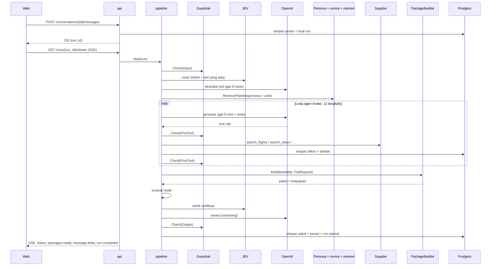

# SYSTEM_ARCHITECTURE.md — Arsitektur Sistem

Dokumen 2 dari 10 · Draft v1 · 14 November 2026

---

## 1. Pola arsitektur

| Pola | Penerapan | Alasan |
|---|---|---|
| **Modular monolith** | Satu codebase Go, dua binary (`api`, `worker`), modul dipisah di `internal/` | Tim kecil; batas modul ditegakkan lewat aturan impor, bukan jaringan. Bisa dipecah jadi service nanti. |
| **Ports and adapters (hexagonal)** | Semua ketergantungan luar (model AI, KG, guardrails, AI Lab, supplier, kurs) ada di balik interface | Tiga komponen pemilik produk belum final; supplier dan model akan berganti. |
| **Pipeline + agent loop** | Langkah tetap dijalankan kode; hanya satu langkah yang berupa loop LLM dengan tools | Yang bisa deterministik dibuat deterministik. Loop LLM dibatasi pada bagian yang memang butuh penalaran. |
| **Event log append-only** | Setiap langkah run menulis `run_events` | Satu sumber untuk streaming ke pengguna, sambung ulang SSE, dan AI Lab. |
| **Deterministic core** | Penyusun paket dan verifikasi invarian adalah fungsi murni | Bisa diuji tuntas tanpa LLM. |

## 2. Diagram konteks

```
                        ┌──────────────┐
                        │   Pengguna   │
                        └──────┬───────┘
                               │ browser
                        ┌──────▼───────┐
                        │  Web (Next)  │
                        └──────┬───────┘
                               │ HTTPS · JSON · SSE
┌──────────────────────────────▼──────────────────────────────┐
│                      Sistem (Go)                             │
│   api  ◄──── Postgres ────►  worker                          │
│    │           Redis            │                            │
└────┼────────────────────────────┼────────────────────────────┘
     │                            │
     ▼                            ▼
┌─────────────────────────────────────────────────────────────┐
│ Eksternal                                                    │
│  AI: OpenAI · JEV (TypeSafe AI)                              │
│  Supplier: Duffel · LiteAPI · Viator/Klook · penyedia kurs   │
│  Milik pemilik produk: Library KG · Guardrails · AI Lab      │
└─────────────────────────────────────────────────────────────┘
```

## 3. Diagram komponen

```
┌───────────────────────────────── api ─────────────────────────────────┐
│                                                                        │
│  transport/http ── middleware (auth, rate limit, request id, CORS)     │
│        │                                                               │
│        ├── auth          ├── conversation      ├── packages (baca)     │
│        │                 │                     │                       │
│        │                 ▼                     │                       │
│        │          ┌─────────────── pipeline ───────────────┐           │
│        │          │ guard-in → router → slot → clarify     │           │
│        │          │ → retrieve → AGENT LOOP → build        │           │
│        │          │ → verify → narrate → guard-out         │           │
│        │          └───┬────────┬─────────┬─────────┬───────┘           │
│        │              │        │         │         │                   │
│        │         session/   agent/    package   verifier               │
│        │         context    tools     builder                          │
│        │              │        │         │         │                   │
│  ──────┴──────────────┴────────┴─────────┴─────────┴────────────────   │
│                              PORTS                                     │
│  ModelProvider · Decider · PersonaKnowledge · UserMemory · Guard       │
│  Tracer · FlightSupplier · StaySupplier · ActivitySupplier · FXProvider│
│  ───────────────────────────────────────────────────────────────────   │
│                             ADAPTERS                                   │
│  openai · jev · openpersona · guardrails · tracer(pg/lab)              │
│  duffel · liteapi · viator · fx                                        │
│                                                                        │
│  store: Postgres (pgx/sqlc) · Redis                                    │
└────────────────────────────────────────────────────────────────────────┘

┌──────────────── worker ────────────────┐
│ River jobs:                            │
│  - refresh price_cache (terjadwal)     │
│  - ringkas percakapan (per run)        │
│  - tulis memori user (akhir sesi)      │
│  - kirim pengingat                     │
│  - bersih-bersih data (retensi)        │
│  - sapu run menggantung                │
└────────────────────────────────────────┘
```

## 4. Komponen dan tanggung jawab

| Komponen | Tanggung jawab | Tidak boleh |
|---|---|---|
| **Web** | Tampilan chat, kartu paket, rincian biaya, timeline; menyambung SSE | Menyimpan logika bisnis; memanggil AI atau supplier langsung |
| **transport/http** | Routing, validasi bentuk request, serialisasi, SSE | Berisi logika domain |
| **auth** | Sesi tamu, login magic link, cookie | — |
| **conversation** | CRUD percakapan dan pesan; membuat run | Menjalankan agen secara langsung (lewat pipeline) |
| **pipeline** | Mengurutkan langkah satu run; memanggil guardrail di titik hook; memancarkan event | Memanggil adapter konkret (hanya port) |
| **router** | Klasifikasi intent dan kelengkapan slot (JEV) | Menghasilkan teks |
| **slot extractor** | Ekstraksi slot ke struktur (gpt-5-nano) | Mengisi slot yang tidak disebut pengguna |
| **session/context** | Menyusun konteks berlapis dalam anggaran token | Menyimpan hasil tool mentah di konteks |
| **agent** | Loop LLM + eksekusi tool dalam batas langkah dan biaya | Menulis harga; menulis ke KG persona |
| **tools** | Jembatan tipis dari panggilan model ke port | Logika bisnis berat |
| **package builder** | Menyusun paket dari kandidat; menghitung total; menentukan kelayakan | Memanggil jaringan atau LLM |
| **verifier** | Invarian kode + rubrik JEV | Mengubah paket (hanya menilai) |
| **narrator** | Menulis penjelasan dari paket yang sudah lolos | Mengubah atau menambah angka |
| **suppliers** | Menerjemahkan query domain ke API supplier dan sebaliknya; cache | Membocorkan tipe supplier ke domain |
| **price index** | Mengisi dan membaca `price_cache` | — |
| **worker** | Pekerjaan asinkron dan terjadwal | Melayani request pengguna |

## 5. Alur utama: satu run perencanaan



Setiap panah dari `pipeline` juga menulis satu `run_events`. Stream SSE dibaca dari event yang berlabel `public`.

## 6. Komunikasi antarkomponen

| Dari → ke | Mekanisme | Catatan |
|---|---|---|
| Web → api | HTTPS JSON (`/api/v1`) | Kontrak OpenAPI; tipe TypeScript digenerate |
| api → Web (streaming) | SSE | Satu stream per run; bisa disambung ulang |
| Modul → modul (dalam proses) | Panggilan fungsi lewat interface | Tidak ada RPC internal |
| api → worker | Job River di Postgres | Transaksional dengan data yang memicunya |
| api/worker → Postgres | pgx pool | Query lewat sqlc |
| api/worker → Redis | go-redis | Cache, rate limit, fan-out event SSE antar-instance |
| Sistem → OpenAI | HTTPS, SDK `openai-go`, Responses API | Streaming untuk narasi |
| Sistem → JEV | HTTPS langsung | Klien tipis buatan sendiri |
| Sistem → supplier | HTTPS | Timeout, retry, circuit breaker per supplier |
| Sistem → KG / guardrails / AI Lab | Lewat port | Bentuk koneksi (in-process atau jaringan) mengikuti library pemilik produk |

### Streaming lintas instance

Run dieksekusi oleh satu instance `api`. Klien SSE bisa tersambung ke instance lain. Karena itu:

1. Pipeline menulis event ke `run_events` (sumber kebenaran).
2. Pipeline mem-publish ID event ke kanal Redis `run:{id}`.
3. Handler SSE membaca event lama dari Postgres (mulai `Last-Event-ID`), lalu mengikuti kanal Redis untuk event baru.

## 7. Eksekusi run

- Run berjalan sebagai goroutine di instance `api` yang menerima pesan, dengan `context` ber-timeout (usul: 120 detik).
- Batas konkurensi per instance memakai semaphore; bila penuh, request ditolak dengan `429` dan `Retry-After`.
- Satu percakapan hanya boleh punya satu run aktif (kunci di Redis + constraint parsial di DB).
- Pembatalan: `POST /runs/{id}/cancel` mem-publish sinyal; pipeline membatalkan `context`.
- Saat shutdown, instance berhenti menerima run baru dan menunggu run aktif sampai batas waktu; sisanya ditandai `failed` dengan `error_code = interrupted`.
- Job worker "sapu run menggantung" menandai run `running` yang melewati batas waktu sebagai `failed`.

Alternatif yang dipertimbangkan: menjalankan run sebagai job worker. Ditolak untuk MVP karena menambah latensi awal dan kerumitan streaming; bisa dipindahkan nanti karena pipeline tidak bergantung pada HTTP.

## 8. Strategi cache

| Data | Tempat | TTL usulan | Kunci |
|---|---|---|---|
| Hasil pencarian penerbangan | Redis + `offers` | 30 menit | asal, tujuan, tanggal, pax, kabin |
| Hasil pencarian penginapan | Redis + `offers` | 60 menit | kota/area, tanggal, tamu |
| Indeks Biaya Destinasi | `price_cache` | 7 hari, di-refresh worker | rute/kota, bulan, tingkat |
| Kurs | `fx_rates` + Redis | 24 jam | pasangan mata uang, tanggal |
| Hasil riset web | Redis | 7 hari | hash pertanyaan ternormalisasi |
| ContextPack KG persona | Redis | 1 jam | destinasi, bulan, minat |

Masa berlaku offer (`expires_at`) mengikuti supplier bila ada; bila tidak, memakai TTL cache.

## 9. Ketahanan terhadap kegagalan

| Kegagalan | Perilaku |
|---|---|
| Supplier timeout/error | Retry sekali dengan jitter; lalu circuit breaker. Tool mengembalikan error terstruktur ke agen; penyusun paket memakai estimasi dari `price_cache`/KG dan menandainya. |
| OpenAI error/timeout | Retry sekali; lalu model cadangan untuk peran itu (konfigurasi). Bila tetap gagal, run `failed` dengan pesan yang bisa diulang. |
| JEV tidak tersedia | Router jatuh ke klasifikasi gpt-5-nano; rubrik verifikasi dilewati dan run ditandai `verification_skipped`. |
| KG tidak tersedia | Run perencanaan dihentikan dengan pesan jelas; tanpa pengetahuan persona, kualitas tidak bisa dijamin. |
| Guardrail tidak tersedia | **Fail closed** untuk titik Input dan Output; konfigurasi per titik. |
| Tracer/AI Lab tidak tersedia | Tidak menggagalkan run; event tetap ada di Postgres dan dikirim ulang. |
| Redis tidak tersedia | Cache dilewati; rate limit jatuh ke batas konservatif di memori; SSE jatuh ke polling Postgres. |

## 10. Deployment

```
 Internet ─► CDN/WAF ─► Load balancer ─┬─► web (Next.js)   × N
                                        └─► api (Go)        × N
                                             worker (Go)    × 1–2
                              Postgres (terkelola, satu primer + cadangan)
                              Redis (terkelola)
```

| Lingkungan | Tujuan |
|---|---|
| `local` | Docker Compose: Postgres, Redis, api, worker, web; semua adapter eksternal bisa diganti stub |
| `staging` | Sama dengan produksi dalam skala kecil; supplier memakai sandbox |
| `production` | Region Indonesia bila tersedia di penyedia cloud yang dipilih |

Konfigurasi lewat variabel lingkungan; rahasia dari secret manager. Lihat `TECH_STACK.md` untuk pilihan infrastruktur.

## 11. Observability

| Sinyal | Isi |
|---|---|
| Trace (OpenTelemetry) | Satu trace per request; span per langkah pipeline, panggilan model, panggilan supplier. `run_id` sebagai atribut. |
| Metrik | Latensi per langkah, token dan biaya per model, hit rate cache, error per supplier, jumlah run aktif, rasio pencarian per klik keluar. |
| Log terstruktur | JSON, berisi `request_id`, `run_id`, `user_id` (ter-hash). Tanpa isi pesan pengguna di level info. |
| `run_events` | Rekaman lengkap run untuk AI Lab (lihat `AI_SYSTEM_DESIGN.md` §11). |

## 12. Batas keamanan

- Web tidak pernah memegang API key pihak ketiga.
- `api` adalah satu-satunya pintu masuk publik; `worker` tidak punya port publik.
- Endpoint internal untuk AI Lab berada di prefix terpisah dengan token layanan dan dibatasi jaringan.
- Konten tak tepercaya (web, deskripsi supplier) membawa penanda asal sejak adapter sampai prompt; lihat `AI_SYSTEM_DESIGN.md` §9.

## 13. Jalur evolusi

| Pemicu | Perubahan |
|---|---|
| Run membebani instance api | Pindahkan eksekusi pipeline ke worker khusus (pipeline sudah bebas HTTP). |
| Kanal baru (WhatsApp) | Tambah adapter transport yang memanggil `conversation` dan mengonsumsi event yang sama. |
| Booking di dalam aplikasi | Modul `order` baru + port `PaymentProvider`; paket sudah menyimpan `offer_id`. |
| Volume event besar | Partisi `run_events` sudah bulanan; arsipkan ke object storage. |

## 14. Penempatan komponen pemilik produk

Berdasarkan kode OpenPersona dan guard-rails-engine yang dibaca pada 14 November 2026.

| Komponen | Bentuk di sistem | Alasan |
|---|---|---|
| **Persona pack** (OpenPersona) | Library di dalam proses `api`. Berkas `.persona` read-only dikirim bersama image atau di-mount; dibuka saat start. | Read-only, jadi aman dipakai banyak instance. Retrieval tanpa LLM dan tanpa jaringan. |
| **Memori user** (OpenPersona) | Layanan terpisah `openpersona serve`, satu instance, dengan volume persisten; hanya di jaringan internal. `api` memanggilnya lewat HTTP. | Penyimpanannya SQLite satu berkas yang ditulis saat runtime, jadi tidak bisa dibagi antar-instance `api`. Server belum punya autentikasi. |
| **Guardrails** (guard-rails-engine) | Library di dalam proses `api` (`pkg/guardrails`). Kebijakan dan `tools.yaml` ada di repo. `Secret` sama di semua instance. | Guard deterministik berjalan sub-milidetik tanpa jaringan; tidak ada titik gagal tambahan. |
| **Tier semantik guardrails** | Tidak dipakai di MVP. Bila diperlukan: gateway guard-rails-engine sebagai layanan, dipanggil lewat `pkg/sdk`. | Model guard butuh infrastruktur sendiri. |
| **Norma biaya** | Tabel `cost_norms` di Postgres kita. | Persona pack tidak membawa data bertipe. |
| **AI Lab** | Belum dilihat. Event tersedia di `run_events` dan lewat port `Tracer`. | — |

```
 api (× N) ── in-process: persona pack (read-only) · guardrails engine
    │
    ├── HTTP internal ──► openpersona serve (× 1, volume) ── mem.db
    └── Postgres ── cost_norms · conversations.guard_session
```

Konsekuensi operasi:

- Layanan memori adalah satu titik gagal untuk fitur memori. Bila mati, run tetap berjalan tanpa blok memori dan penulisan diantrekan ulang lewat job.
- Cadangan `mem.db` masuk jadwal cadangan.
- Merilis persona pack baru berarti merilis image baru (atau memuat ulang berkas); versi pack tercatat di setiap run.
- Kedua library masih pra-1.0: versinya dipaku di `go.mod`, dan kenaikan versi melewati golden set.
